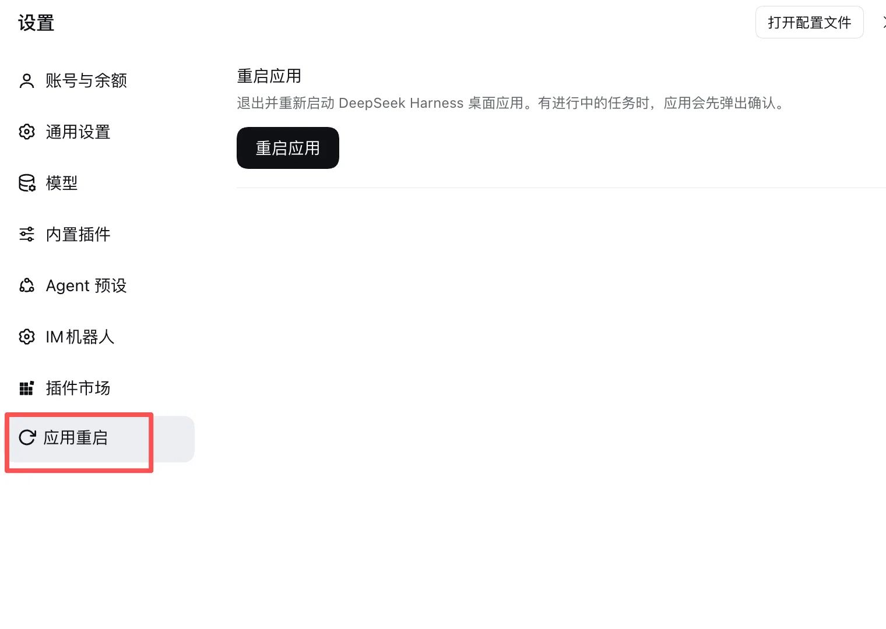

# dsh-app-restart

Adds a **Restart application** section to the DeepSeek Harness desktop app Settings, with a guarded button that restarts the whole application — the Electron shell, the hosted Web GUI, and the cordis Host process.

English | [中文](README.zh.md)



## What it does

- Settings gains a new section ("Restart App") listing what the restart will do and whether the environment supports it.
- The button is two-step (click, then confirm) to prevent accidental restarts.
- Restart = **graceful quit + automatic relaunch**:
  1. a detached relauncher waits for the app main process to exit, then reopens the app bundle;
  2. the plugin triggers the platform's normal quit path — on macOS the Quit Apple Event, which the shell treats exactly like Cmd+Q, including its active-task confirmation dialog;
  3. if the user cancels that dialog, the relauncher times out and its final `open` merely focuses the running app — a harmless no-op.

The Electron shell offers plugins no restart IPC (`app.relaunch()` is main-process only), so the restart is orchestrated at the OS level from the Host process. No DSH source modifications are needed.

## Install

### From GitHub (one command)

```sh
dsh plugin --profile desktop add "https://github.com/foreee/dsh-app-restart"
```

The Web **Plugins** page can install the same address through its install-by-path/git dialog.

### Manual equivalent

The two steps the plugin manager performs:

```sh
cd ~/.dsh/profiles/desktop
pnpm add "file:/absolute/path/to/dsh-app-restart"   # or the GitHub address
# then add "dsh-app-restart" to package.json -> dsh.profile.bundles
```

Restart the desktop app once to load the plugin; the section appears under Settings from then on.

## Routes

| Route | Method | Purpose |
| --- | --- | --- |
| `api/dsh-app-restart/status` | GET | availability facts for the button |
| `api/dsh-app-restart/restart` | POST | perform the restart |

Both sit behind a loopback-only trust fence (loopback socket **and** loopback Host header, same-origin markers enforced). Paired remote devices are deliberately rejected: only the machine's own GUI may restart the app.

## Configuration

| Field | Default | Meaning |
| --- | --- | --- |
| `enabled` | `true` | set `false` to mount nothing |
| `dryRun` | `false` | `POST /restart` answers with the computed plan and spawns nothing — for verification |

## Platform support

| Platform | Quit via | Relaunch via | Status |
| --- | --- | --- | --- |
| macOS | Quit Apple Event (bundle id, then app name) | `open <bundle>` after the main PID exits | primary target |
| Windows | `taskkill /PID` (graceful WM_CLOSE) | PowerShell `Start-Process` after the PID exits | best effort; if the app cannot be closed gracefully the relauncher still reopens it after the next manual quit |
| Linux | `SIGTERM` | `nohup <exe>` after the PID exits | best effort |

The plugin refuses to run against a development Electron checkout (no `app.asar` beside the executable, or the generic `com.github.Electron` bundle id) — a stray relaunch of the generic Electron binary would not boot DSH anyway.

## Development

The client half (`lib/client.js`) is a hand-written `window.__ModuleLoader__` bundle — the same shape tsdown emits for official client plugins — so no build step is required; edit and reinstall.

```sh
# one-time test setup (kept out of the plugin manifest on purpose)
npm i react@18.3.1 react-dom@18.3.1 react-test-renderer@18.3.1 --prefix test/react-env --cache test/react-env/.npm-cache

node test/plan.test.mjs        # plan builder + trust fence
node test/client.test.mjs      # browser bundle: registration + interaction flow
node test/host-routes.test.mjs # host routes: guards, status, dry-run, dispose
```

## License

[MIT](LICENSE)
